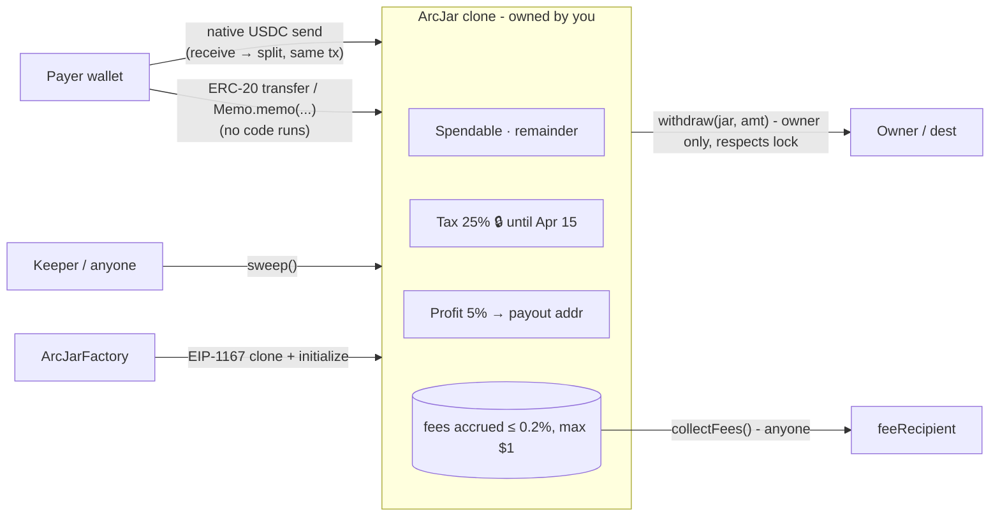

# ArcJars 🫙

**Every USDC payment, auto-split into your own jars, on Arc.**
Tax money is locked until tax day, profit is set aside, and the rest is yours to spend. It is non-custodial, with one address and no backend.


## The problem

Freelancers, creators and small shops paid in stablecoins get **one lump** of USDC and must remember to set aside tax, savings and profit by hand. Most don't, and they find out in April. Banks offer "envelope" or "Profit First" sub-accounts. Crypto wallets don't.

## The idea

ArcJars gives you **one payment address** (a tiny contract you own) with up to 8 jars:

| Jar | Example | Rules |
|---|---|---|
| Spendable | gets the remainder | withdraw any time |
| Tax | 25 % | **time-locked** until 15 Apr. The lock can only be extended, never shortened |
| Profit | 5 % | optional fixed payout address |
| Emergency | 10 % | locked for 30 days |

Anyone pays the address the normal way, or uses the **pay-me link / QR**. The contract splits the payment **in the same transaction**, and the dashboard shows the jars filling up, with live lock countdowns.

Why Arc: USDC is the **native gas token**, so a payment is just a value transfer. The split costs about $0.001, finality is sub-second, and Arc's **Memo** contract lets payers attach an invoice reference.

| Pay page | Create | 中文 UI |
|---|---|---|
|  |  |  |

*(The screenshots are from the app running headless Chrome against an `arc-anvil` fork of Arc testnet.)*

## How it works



* **`ArcJarFactory`** deploys one `ArcJar` implementation. `createJar(salt, configs)` deploys a deterministic EIP-1167 clone owned by the caller. A clone costs about 300k gas, a fraction of a cent.
* **`receive()`** splits `msg.value` immediately: `fee = min(amount × 0.2 %, 1 USDC)`, then each jar *i ≥ 1* gets `net × bps_i / 10 000`, and rounding dust goes to Spendable. Accounting is exact (fuzzed and invariant-tested).
* **`sweep()`** (permissionless) splits `address(this).balance − allocated`. This covers money that arrived **without running code**: ERC-20 `transfer` on the USDC interface `0x3600…0000`, Memo payments, `selfdestruct`. The [keeper](keeper/) calls it automatically.
* **`withdraw(jarId, amount, to)`**: owner only. It reverts with `Locked(unlockAt)` before the unlock time. If the jar has a `dest`, funds always go there. `type(uint256).max` withdraws everything.
* Owner config: `addJar`, `setSplits`, `extendLock` (forward only, at most 10 years), `setDest`, `transferOwnership`.

### Arc specifics we verified

| Fact | How we checked it |
|---|---|
| Native USDC has **18 decimals**. The ERC-20 view at `0x3600…` reports the **same balance with 6 decimals** (`balanceOf == native / 1e12`) | real testnet RPC |
| An ERC-20 `transfer` to a contract does **not** execute its code, so `sweep()` is needed | real testnet: a transfer to an always-reverting contract succeeds |
| A native value send **does** execute `receive()` | real testnet |
| A wallet-estimated payment to a jar uses about **74k gas** (1 USDC, 3 jars) | real testnet `eth_estimateGas` with state override |
| `Memo.memo(target, data, memoId, memoData)` is EOA-only and routes the call through CallFrom | e2e on fork: memo pay, then sweep |
| The mempool drops txs with `maxFeePerGas < 20 gwei` | deploy script and keeper enforce a 20 gwei floor |

All contract accounting uses 18-decimal native units. The app converts to 6 decimals only when it builds an ERC-20/Memo `transfer`.

## ⚠️ Low-gas finding: don't pay from an exchange

On the real Arc testnet node, a value transfer to a jar with a **fixed 21 000 gas limit fails** (`out of gas: gas required exceeds: 21000`). This holds for **any** contract recipient on Arc, not only ArcJars: a clone's `delegatecall` alone exceeds 21k, and a Solidity 2300-gas `transfer()` stipend fails too.

* **No funds are lost.** The tx reverts and the payer keeps the USDC, losing only about $0.0004 of gas.
* Wallets (MetaMask, Rabby, viem/ethers) estimate gas, so they work: the e2e native pay estimated 108k gas.
* **Exchange withdrawals** usually hard-code 21k gas and will fail. The pay page warns about this. Alternative: send USDC through the ERC-20 interface, then the keeper sweeps it.
* We deliberately **don't** add a "low gas → defer split" branch in `receive()`. `eth_estimateGas` returns the *cheapest successful* gas, so wallets would always pick the deferred path, and every payment would need a sweep. A test pins this behavior.

## Fee model

* **0.2 % of each payment, capped at 1 USDC.** `MAX_FEE_BPS = 20` is a compile-time constant, and the fee is set once at factory deploy. Nobody can raise it, and there is no admin, pause or upgrade.
* Fees accrue inside each jar (no external call in `receive()`). Anyone can push them to the immutable `feeRecipient` with `collectFees()`.
* Example: a $1 200 invoice pays a $1.00 fee, $350 pays $0.70, and $80 pays $0.16.

## Security notes

* **Non-custodial and immutable.** No proxy admin, no owner on the factory, no pause. The implementation is locked (`owner = 0xdead`), so it cannot be initialized.
* **Reentrancy**: `ReentrancyGuardTransient` (EIP-1153) on `withdraw`, `sweep` and `collectFees`, with checks-effects-interactions. Reentrancy tests attack all three.
* **Solvency invariant**: `Σ jar balances + feesAccrued == allocated ≤ address(this).balance`. It is checked by a stateful invariant fuzzer (128 runs × 64 calls, 0 reverts).
* Locks only move forward, with a maximum of 10 years. `dest` overrides the `withdraw` recipient (a convenience for fixed payouts, not a security boundary: `setDest` is owner-only too). Withdrawing to the jar itself or to `address(0)` is rejected.
* **USDC blocklist**: if Circle blocklists the jar or a recipient, native transfers revert, and funds stay safe in the jar until resolved.
* Payouts are native sends with full gas forwarding. If the owner is a contract whose `receive` reverts, withdraw to another `to`.
* **Not audited.** This is hackathon / microgrant code, so use small amounts.

## Tests

```
forge test          # 38 tests: 34 unit, 2 fuzz (1 000 runs), 2 invariants (128 × 64)
```
They cover splits and dust, the fee cap, 8-jar gas (146k for the first payment), sweep after ERC-20/self-destruct, locks, dest, guards, setSplits/addJar limits, ownership, collectFees, low-gas revert, and reentrancy on all three external-call paths.

### End-to-end (Arc testnet fork)

`scripts/e2e.sh` (`FORK=1` against `arc-anvil --network arc --fork-url https://rpc.testnet.arc.io`) runs the full flow, starting with the factory deploy. It creates a jar (Tax 25 % locked for 1 h, Profit 5 %) and runs a native pay, an ERC-20 pay plus sweep, a Memo pay plus sweep, the fixed-21k transfer (reverts), a withdraw, a Tax withdraw before unlock (`Locked`), a time warp then Tax withdraw, and collectFees. Results are in [`deployments/e2e-arc-testnet-fork.json`](deployments/e2e-arc-testnet-fork.json).
Real-node checks (read-only `eth_call` / `eth_estimateGas` with state overrides): [`deployments/real-testnet-checks.txt`](deployments/real-testnet-checks.txt), script [`scripts/verify_real_testnet.py`](scripts/verify_real_testnet.py).

> The Circle faucet is behind reCAPTCHA, so the e2e ran on a local `arc-anvil` fork of Arc testnet (same chain id, same USDC/Memo precompiles). The low-gas and ERC-20 facts above were then confirmed against the real testnet node.

## Run it

```bash
# contracts
cd contracts && forge test

# app (Vite + TypeScript + viem; static, no backend)
cd app && npm i && npm run dev
#   ?net=arc|arc-testnet|local  ?factory=0x…  ?watch=0x…(read-only view)  ?lang=zh
#   #/pay/<jar>?amount=250&memo=INV-1   → pay-me page with QR
npm run build   # → app/dist, deploy anywhere (GitHub Pages workflow included)

# keeper (permissionless sweeper; any funded key)
cd keeper && npm i && RPC_URL=… FACTORY=0x… FROM_BLOCK=… KEEPER_PK=0x… npm start   # DRY_RUN=1 / ONCE=1
```

## Deploy to Arc mainnet

1. Install [Arc Foundry](https://github.com/circlefin/arc-foundry) (`arc-forge`/`arc-cast`) or a recent upstream Foundry with `osaka` support.
2. Fund a deployer with about 1 USDC on Arc (chain 5042). The deploy costs about 0.13 USDC at 41 gwei.
3. Run:
   ```bash
   DEPLOYER_PK=0x… ./scripts/deploy_mainnet.sh          # add VERIFY=1 to verify on the explorer
   ```
   The script checks chain id 5042 and the deployer balance, and enforces the ≥ 20 gwei fee floor. It asks you to type `DEPLOY`, then deploys `ArcJarFactory(feeRecipient = 0xc7AC1469a8dc7E4df3CE2D646dd6D01296548CEd, feeBps = 20)` and writes `deployments/arc-mainnet.json`.
   A rehearsal against a local fork works: `ARC_RPC_URL=http://127.0.0.1:8545 EXPECTED_CHAIN_ID=5042002`.
4. Build the app with `VITE_FACTORY_ARC=<factory>` (or set the repo variable for the Pages workflow), and start the keeper.

## Repo layout

```
contracts/   ArcJar.sol, ArcJarFactory.sol, Deploy.s.sol, tests (Foundry, solc 0.8.30, osaka)
app/         Vite + TS + viem dApp (EN/中文), pay-me link + QR, Memo payments
keeper/      Node sweeper/fee-collector
scripts/     e2e.sh, deploy_mainnet.sh, verify_real_testnet.py, seed_demo.sh
deployments/ e2e + real-node evidence
```

MIT © ArcJars contributors
