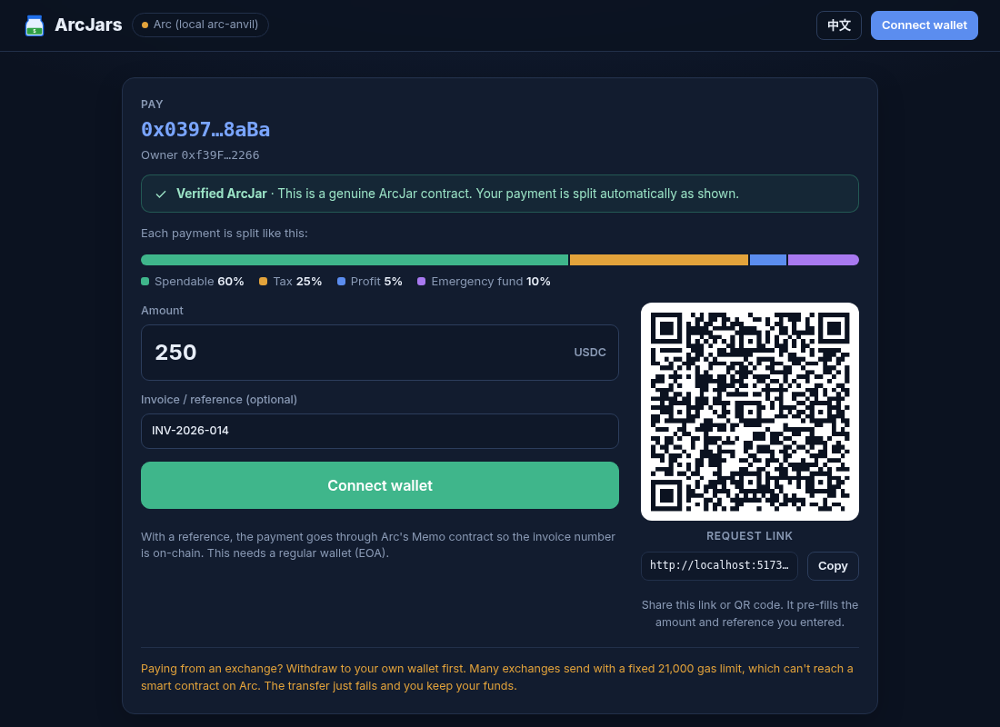
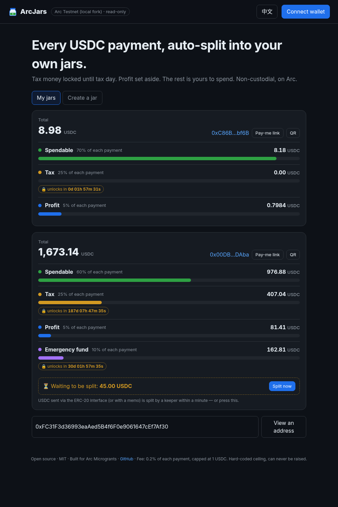
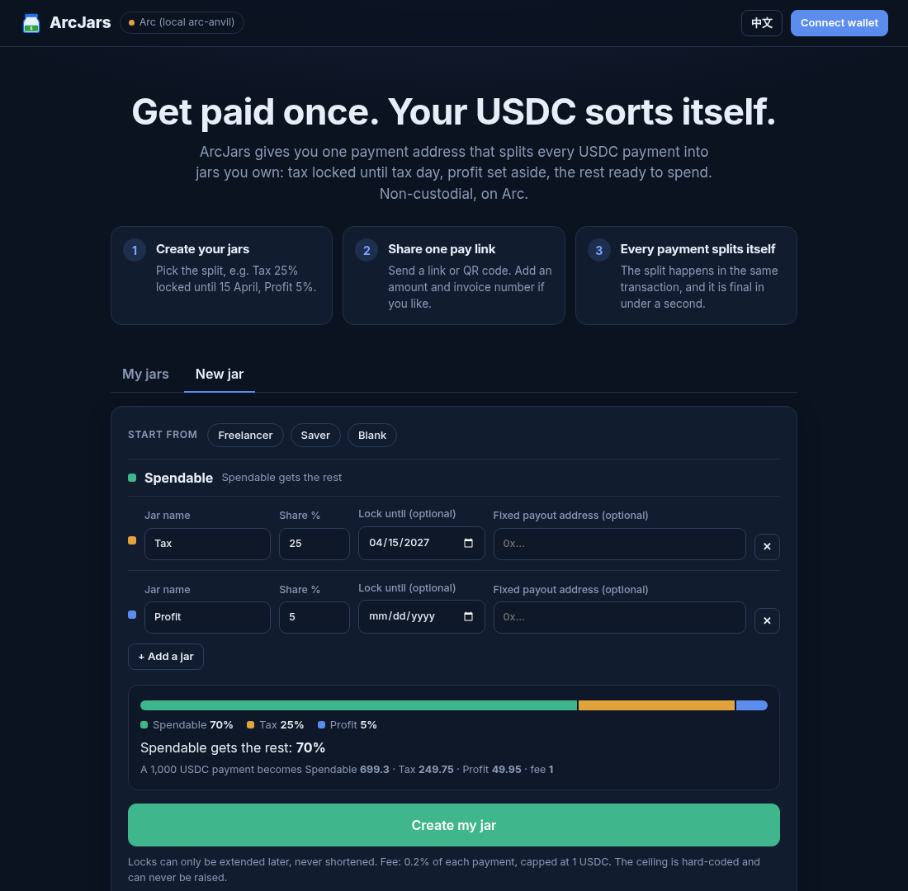
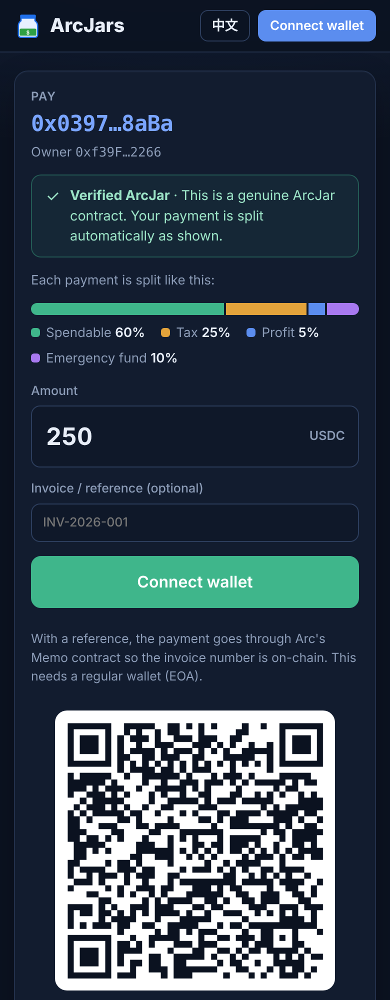
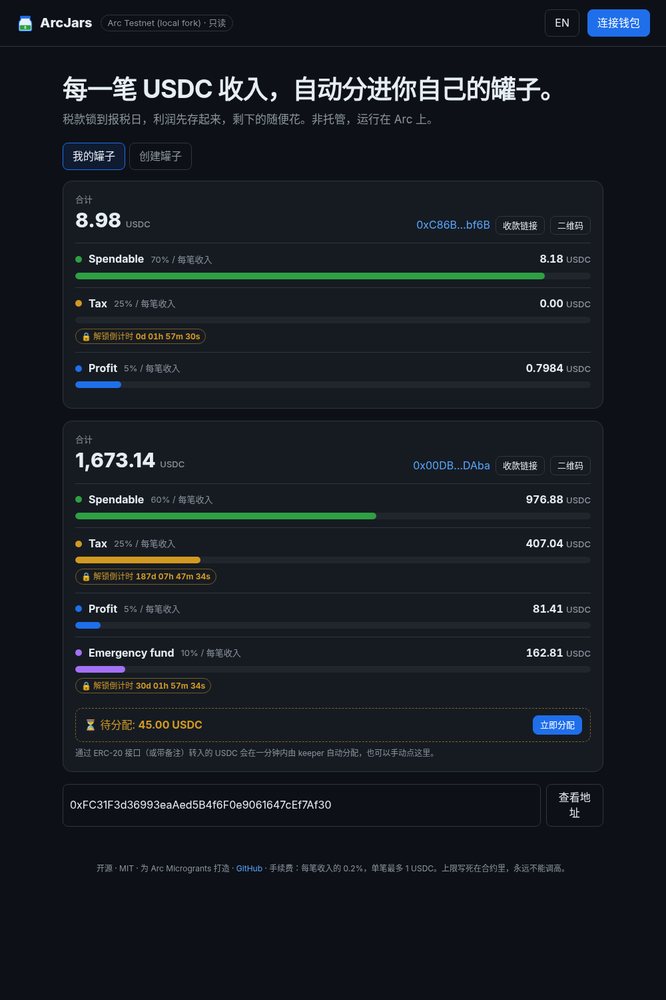
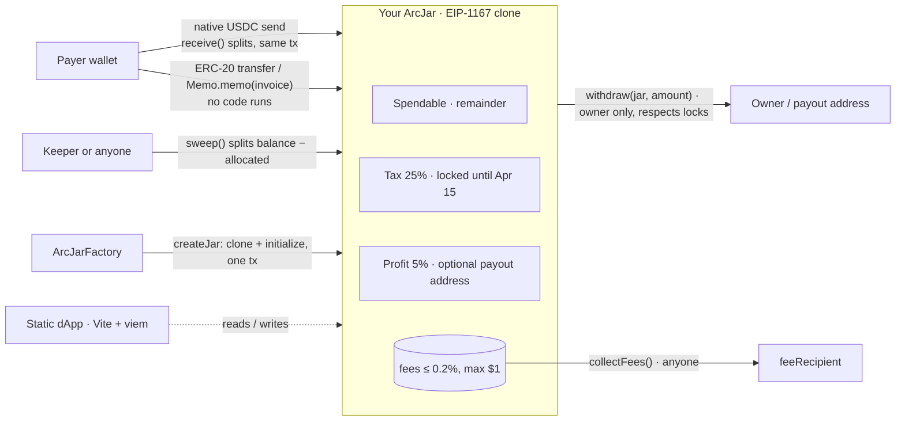

# ArcJars 🫙

**One payment link that auto-splits every USDC payment into jars you own: tax locked until tax day, profit set aside, the rest ready to spend.**

Non-custodial · no backend · no admin keys · 0.2% fee capped at $1 · EN / 中文

**Live on Arc mainnet:** **[https://whhhh1500.github.io/arcjars/](https://whhhh1500.github.io/arcjars/)** · try the [verified pay page of a real mainnet jar](https://whhhh1500.github.io/arcjars/#/pay/0xbB510A19E53049a5d773dcd53DE13F3D467284c7) · [testnet evidence](#testnet-evidence-real-arc-testnet-chain-5042002)

| Arc mainnet (chain 5042) | Address |
|---|---|
| ArcJarFactory | [`0xbf3e65533144e951ee245d04b8b53b733e92bd63`](https://explorer.arc.io/address/0xbf3e65533144e951ee245d04b8b53b733e92bd63) · [Sourcify ✓ exact match](https://repo.sourcify.dev/5042/0xbf3e65533144e951ee245d04b8b53b733e92bd63) |
| ArcJar implementation | [`0x433188a700d393285dd55451d7a7e58e3fdada66`](https://explorer.arc.io/address/0x433188a700d393285dd55451d7a7e58e3fdada66) · [Sourcify ✓ exact match](https://repo.sourcify.dev/5042/0x433188a700d393285dd55451d7a7e58e3fdada66) |
| Deploy tx | [`0xb09e77e9a7f3123d…`](https://explorer.arc.io/tx/0xb09e77e9a7f3123d6b286a5a2816459a3e345341284830815ce757030a908e5f) (block 25106785) |
| Fee | 0.2% (20 bps), capped at 1 USDC, to `0xc7AC1469a8dc7E4df3CE2D646dd6D01296548CEd` |

Real-funds smoke test on mainnet: jar [`0xbB510A19E53049a5d773dcd53DE13F3D467284c7`](https://explorer.arc.io/address/0xbB510A19E53049a5d773dcd53DE13F3D467284c7) (Tax 25% locked 30 days / Profit 5% / Spendable 70%) was
[created](https://explorer.arc.io/tx/0x6f3fc21f03c868c486d2b81d129cae15a4c89e321eea9c2ac00ba3a3a522e2a2), [paid 0.5 USDC natively](https://explorer.arc.io/tx/0x29900664f94ef4c975fcb1122acc0259edaa20a645423d39879937a3ed527871) → split 0.3493 / 0.12475 / 0.02495 + 0.001 fee in the same tx,
and the Spendable part was [withdrawn](https://explorer.arc.io/tx/0xfd698eeb3c00099eb47d146829039dff646223ca0015509c53bf0be78bfe53fc). Details: [deployments/arc-mainnet.json](deployments/arc-mainnet.json).
A permissionless keeper (`keeper/keeper.mjs`, restart with `scripts/keeper_start.sh`) runs against mainnet every 60 s and sweeps ERC-20 / Memo payments into the jars.

| 1. Share a pay link or QR | 2. The payment splits in the same transaction | 3. Set it up in one transaction |
|---|---|---|
|  |  |  |

<sub>These are the real app running against a local `arc-anvil` Arc chain. `scripts/screenshots.sh` regenerates them.</sub>

### Why Arc

* **USDC is the native coin.** A payment is a plain value transfer, so the contract can split it inside `receive()` in the *same transaction*. There is no approve, no wrapper and no "claim" step.
* **Sub-second finality and dollar-denominated gas.** The split costs about $0.001 and is final before the payer closes their wallet. That makes per-invoice splitting practical for freelancers and small shops.
* **Arc-native building blocks.** It uses Arc's **Memo** contract for on-chain invoice references, and the 6-decimal ERC-20 interface so exchange-style transfers work too: they arrive unsplit and `sweep()` splits them, never twice (see [SECURITY_REVIEW.md](SECURITY_REVIEW.md)).

### 30-second demo

1. **Create:** pick a template (Freelancer: Tax 25% locked until 15 April, Profit 5%). One transaction deploys your personal jar contract.
2. **Share:** copy the pay link or show the QR code. Add `amount` and an invoice number, and the link and QR update live.
3. **Get paid:** the payer opens the link and sees a **Verified ArcJar** badge and exactly how the money will be split, then pays from any wallet. The dashboard shows every jar filling up, with live lock countdowns. Tax can't be withdrawn early, not even by you.

```bash
scripts/demo_local.sh     # local arc-anvil chain + 2 seeded demo jars (public dev keys only)
scripts/screenshots.sh    # regenerates every screenshot in docs/ from that demo
```

<details><summary>Mobile and 中文 screenshots</summary>

| Mobile pay page | 中文 dashboard |
|---|---|
|  |  |

</details>

### Architecture



---

## Testnet evidence (real Arc testnet, chain 5042002)

`scripts/e2e.sh` against `https://rpc.testnet.arc.io` with no fork. Factory [`0x9b0e9dfd78a24ff6a5e0e82c30649617f13fbbf4`](https://explorer.testnet.arc.io/address/0x9b0e9dfd78a24ff6a5e0e82c30649617f13fbbf4), jar [`0x3d63b711495f8438f38a9c9A448e010addCC04b7`](https://explorer.testnet.arc.io/address/0x3d63b711495f8438f38a9c9A448e010addCC04b7). Full record: [deployments/arc-testnet.json](deployments/arc-testnet.json).

| Step | Tx |
|---|---|
| Deploy factory + implementation | [`0x19679d95…`](https://explorer.testnet.arc.io/tx/0x19679d958bba881e4ab84fffaff22e98f0e42ed6318d9d553bffc6ed383daddf) |
| Create jar (Tax 25% locked 1h / Profit 5% / Spendable 70%) | [`0x16fc8da7…`](https://explorer.testnet.arc.io/tx/0x16fc8da7291f151eea2201871f04934f586a4bcf8f0a5edfcdcad45aa11f7dc4) |
| Native 10 USDC payment, split inside receive() | [`0xcc8c3e78…`](https://explorer.testnet.arc.io/tx/0xcc8c3e78bd643c4e9afd30d21b617f878dd680f5c378aabe7b3a13d4672a662f) |
| ERC-20 transfer 4 USDC (arrives unsplit) | [`0x28b9b328…`](https://explorer.testnet.arc.io/tx/0x28b9b328d572aed04850162d53ba3839b552a2c6a3b8499a2e05a10bacb76c3a) |
| sweep() splits it | [`0x41b778e1…`](https://explorer.testnet.arc.io/tx/0x41b778e19fef5b8e9bde8eaba870a241ad0c807a2242ea30a1347cada5cf81bf) |
| Memo-tagged invoice payment (INV-2026-001) | [`0x8bd17907…`](https://explorer.testnet.arc.io/tx/0x8bd17907c5aef2f32f04f3934150ddf5f3909eb2d19ae0287319152c6e545753) |
| sweep() | [`0x38fdd5ca…`](https://explorer.testnet.arc.io/tx/0x38fdd5ca06b00fb41a20708c53345073ab01c770414df69d3d01be6546e7d6d4) |
| Exchange-style 21000-gas send → reverts OOG, payer keeps funds (expected) | [`0x9cf7938b…`](https://explorer.testnet.arc.io/tx/0x9cf7938bfc2af31fce94d48202f621a148e306817478c6e0e49fd8d029b8781d) |
| Owner withdraws 3 USDC Spendable (Tax withdraw reverts Locked) | [`0xc7b0a8a0…`](https://explorer.testnet.arc.io/tx/0xc7b0a8a086634cffd364f9fed375a4a101c656a6df24915a140f215160281a06) |
| collectFees() → feeRecipient gets exactly 0.2% | [`0x3239f1d1…`](https://explorer.testnet.arc.io/tx/0x3239f1d18abbd0379f0a17837952d9fe7980d66d447fbb595a853ee3ac813420) |

Real-chain bonus: an unrelated address dusted the brand-new jar with 0.032388 USDC by ERC-20 seconds after creation. The jar counted it as unallocated, `sweep()` split it like any other payment, and the fee came out at exactly 0.2% of everything received.

## The problem

Freelancers, creators and small shops paid in stablecoins get **one lump** of USDC and must remember to set aside tax, savings and profit by hand. Most don't, and they find out at tax time. Banks offer "envelope" or "Profit First" sub-accounts. Crypto wallets don't.

## How it works

ArcJars gives you **one payment address** (a tiny contract you own) with up to 8 jars:

| Jar | Example | Rules |
|---|---|---|
| Spendable | gets the remainder | withdraw any time |
| Tax | 25 % | **time-locked** until 15 Apr. The lock can only be extended, never shortened |
| Profit | 5 % | optional fixed payout address |
| Emergency | 10 % | locked for 30 days |

* **`ArcJarFactory`** deploys one `ArcJar` implementation. `createJar(salt, configs)` deploys a deterministic EIP-1167 clone owned by the caller, so the pay link can be shared even before the jar exists.
* **`receive()`** splits `msg.value` immediately: `fee = min(amount × 0.2 %, 1 USDC)`, then each jar *i ≥ 1* gets `net × bps_i / 10 000`, and rounding dust goes to Spendable. Accounting is exact (fuzzed and invariant-tested).
* **`sweep()`** (permissionless) splits `address(this).balance − allocated`. This covers money that arrived **without running code**: ERC-20 `transfer` on the USDC interface `0x3600…0000`, Memo payments, `selfdestruct`. The [keeper](keeper/) calls it automatically.
* **`withdraw(jarId, amount, to)`**: owner only. It reverts with `Locked(unlockAt)` before the unlock time. If the jar has a `dest`, funds always go there.
* Owner config: `addJar`, `setSplits`, `extendLock` (forward only, at most 10 years), `setDest`, two-step `transferOwnership` / `acceptOwnership`, and `rescueToken` for non-USDC tokens sent by mistake (USDC can never leave this way).
* **The app** is a static Vite + TypeScript + viem site with no backend. It has a pay page with a live QR code and request links (amount + invoice), a *Verified ArcJar* check (runtime code must equal a clone of the official implementation), and plain-language errors for wallet rejection, insufficient funds and locked jars. It works on mobile and in English and Chinese.

### Arc specifics we verified

| Fact | How we checked it |
|---|---|
| Native USDC has **18 decimals**. The ERC-20 view at `0x3600…` reports the **same balance with 6 decimals** (`balanceOf == native / 1e12`) | real testnet RPC + fork e2e |
| An ERC-20 `transfer` to a contract does **not** execute its code, so `sweep()` is needed | real testnet: a transfer to an always-reverting contract succeeds |
| A native value send **does** execute `receive()` | real testnet |
| A wallet-estimated payment to a jar uses about **74k gas** (1 USDC, 3 jars) | real testnet `eth_estimateGas` with state override |
| `Memo.memo(target, data, memoId, memoData)` is EOA-only and routes the call through CallFrom | e2e on fork (memo pay, then sweep) + UI test |
| The mempool drops txs with `maxFeePerGas < 20 gwei` | deploy script and keeper enforce a 20 gwei floor |

All contract accounting uses 18-decimal native units. The app converts to 6 decimals only when it builds an ERC-20/Memo `transfer`.

## ⚠️ Low-gas finding: don't pay from an exchange

On the real Arc testnet node, a value transfer to a jar with a **fixed 21 000 gas limit fails** (`out of gas: gas required exceeds: 21000`). This holds for **any** contract recipient on Arc, not only ArcJars: a clone's `delegatecall` alone exceeds 21k, and a Solidity 2300-gas `transfer()` stipend fails too.

* **No funds are lost.** The tx reverts and the payer keeps the USDC, losing only about $0.0004 of gas.
* Wallets (MetaMask, Rabby, viem/ethers) estimate gas, so they work: the e2e native pay estimated 108k gas.
* **Exchange withdrawals** usually hard-code 21k gas and will fail. The pay page warns about this. Alternative: send USDC through the ERC-20 interface, then the keeper sweeps it.
* We deliberately **don't** add a "low gas → defer split" branch in `receive()`. `eth_estimateGas` returns the *cheapest successful* gas, so wallets would always pick the deferred path, and every payment would need a sweep. A test pins this behavior.

## Fee model

* **0.2 % of each payment, capped at 1 USDC.** `MAX_FEE_BPS = 20` is a compile-time constant, and the fee is set once at factory deploy. Nobody can raise it, and there is no admin, pause or upgrade.
* Fees accrue inside each jar (no external call in `receive()`). Anyone can push them to the immutable `feeRecipient` with `collectFees()`.
* Example: a $1,200 invoice pays a $1.00 fee, $350 pays $0.70, and $80 pays $0.16.

## Security

An independent review is in **[SECURITY_REVIEW.md](SECURITY_REVIEW.md)**. It found no critical or high issues. Medium and low issues were fixed with tests, including the rescue path for stray EURC and other tokens, two-step ownership, and app-side XSS and phishing hardening.

* **Non-custodial and immutable.** No proxy admin, no owner on the factory, no pause. The implementation is locked (`owner = 0xdead`).
* **No double counting.** Native payments are split once in `receive()`, and ERC-20/Memo arrivals once in `sweep()`. A fuzz test and a ghost-accounting invariant prove `unallocated == unswept ERC-20` and conservation of funds.
* **Reentrancy**: `ReentrancyGuardTransient` (EIP-1153) on `withdraw`, `sweep`, `collectFees` and `rescueToken`, with checks-effects-interactions.
* **A payer never loses funds**: any failure in `receive()` (low gas, fixed 21k gas, blocklist) reverts the whole payment.
* **Not audited by a third party.** This is microgrant-stage code, so use small amounts.

## Tests

```
cd contracts && forge test    # 48 unit + 3 fuzz (1,000 runs) + 3 invariants (128 × 64)
```
* The contract tests cover splits and dust, the fee cap across 6/18 decimals, double-count fuzzing, 8-jar gas (receive 146k, sweep 138k), sweep after ERC-20 and self-destruct, locks, dest, guards, two-step ownership, rescue, front-running a predicted address, the low-gas revert, and reentrancy on every external-call path.
* **End-to-end on an Arc testnet fork:** `ENV_FILE=… RPC_URL=… FORK=1 scripts/e2e.sh` runs deploy, create, native pay, ERC-20 pay + sweep, Memo pay + sweep, the fixed-21k revert, lock, withdraw, fees, rescue guard and ownership. Log: [`deployments/e2e-arc-testnet-fork.log`](deployments/e2e-arc-testnet-fork.log).
* **Real-node checks** (read-only `eth_call` / `eth_estimateGas` with state overrides): [`deployments/real-testnet-checks.txt`](deployments/real-testnet-checks.txt).
* **UI:** `app/scripts/ui-e2e.mjs` runs 23 headless-Chrome checks against the local demo with an injected test wallet.

## Run it

```bash
# contracts
cd contracts && forge test

# app (static, no backend)
cd app && npm i && npm run dev
#   ?net=arc|arc-testnet|local  ?watch=0x…(read-only view)  ?lang=zh
#   #/pay/<jar>?amount=250&memo=INV-1   → pay page with QR
npm run build   # → app/dist, deploy anywhere (GitHub Pages workflow included)

# keeper (permissionless sweeper; any funded key)
cd keeper && npm i && RPC_URL=… FACTORY=0x… FROM_BLOCK=… KEEPER_PK=0x… npm start   # DRY_RUN=1 / ONCE=1
```

## Deploy to Arc mainnet

1. Install [Arc Foundry](https://docs.arc.io/arc/tutorials/install-arc-foundry.md) (`arc-forge`/`arc-cast`).
2. Fund a deployer with about 1 USDC on Arc (chain 5042). The deploy costs a few cents.
3. Run `DEPLOYER_PK=0x… ./scripts/deploy_mainnet.sh` (add `VERIFY=1` to verify on the explorer). The script:
   * checks chain id 5042 and the deployer balance, and enforces the ≥ 20 gwei fee floor;
   * asks you to type `DEPLOY`, then deploys `ArcJarFactory(feeRecipient = 0xc7AC1469a8dc7E4df3CE2D646dd6D01296548CEd, feeBps = 20)`;
   * **reads the immutables back from chain** and fails on any mismatch, then writes `deployments/arc-mainnet.json`.

   You can rehearse it first: `ARC_RPC_URL=http://127.0.0.1:8545 EXPECTED_CHAIN_ID=5042002 …` against `scripts/demo_local.sh`.
4. Build the app with `VITE_FACTORY_ARC=<factory>` (or set the repo variable for the Pages workflow), and start the keeper.

## Repo layout

```
contracts/   ArcJar.sol, ArcJarFactory.sol, Deploy.s.sol, tests (Foundry, solc 0.8.30, osaka)
app/         Vite + TS + viem dApp (EN/中文): dashboard, create, pay page + QR, Memo payments, ui-e2e
keeper/      Node sweeper / fee collector
scripts/     deploy_mainnet.sh, e2e.sh, demo_local.sh, screenshots.sh, verify_real_testnet.py
deployments/ e2e + real-node evidence
SECURITY_REVIEW.md
```

MIT © ArcJars contributors
